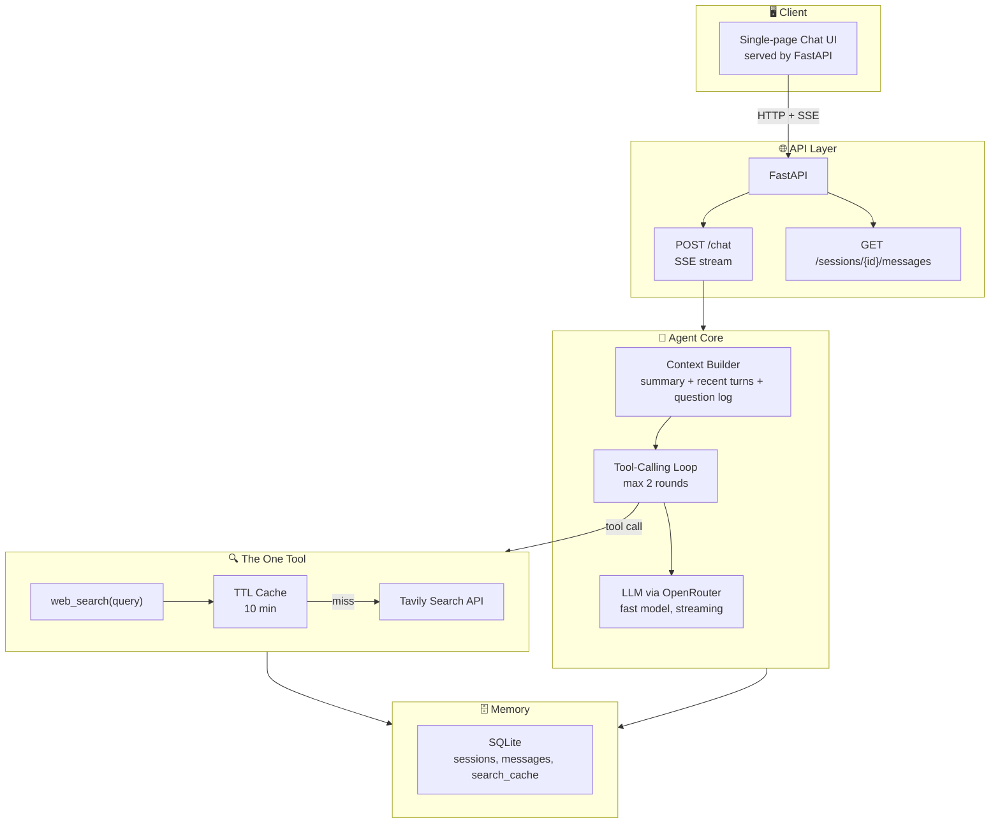
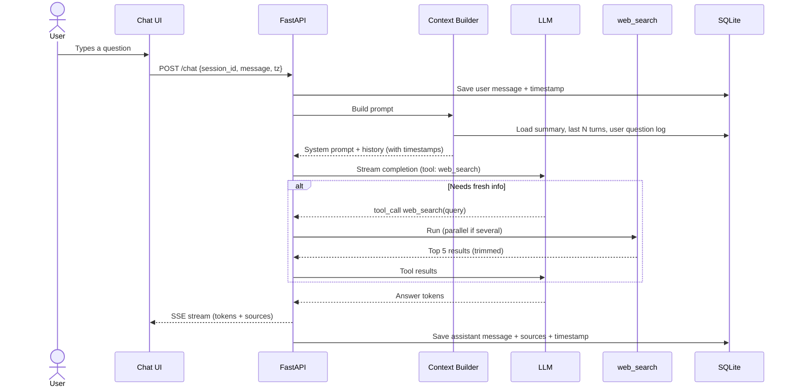
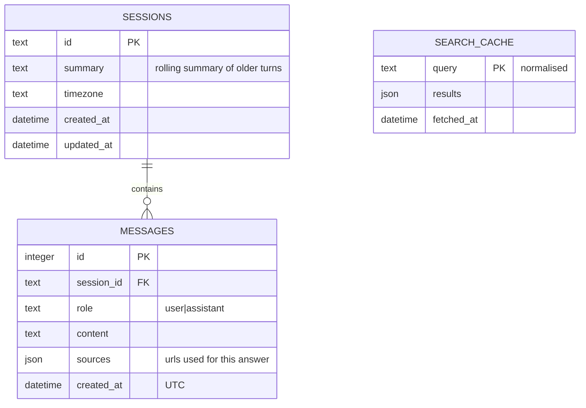

# Search Chat Agent — Design & Architecture

> A chat agent with exactly one tool: web search. Built to answer fast, stay correct, and remember what you asked and when.

---

## 1. Goals & Constraints

| Goal | What it means | How we get there |
|------|---------------|------------------|
| **Fast** | First token in under ~1s for chat, under ~4s when a search is needed | Streaming, search only when needed, parallel searches, result caching |
| **Correct** | Answers match real sources, and the agent admits when it doesn't know | Today's date in the prompt, citations, strict "no search result, no claim" rule |
| **Remembers** | Can answer "what did I ask earlier?" and "when did I ask it?" | Every message stored with a timestamp, history rebuilt into each prompt |
| **One tool** | Only `web_search` is exposed to the model | Memory is plain code in the backend, not a second tool |

**Non-goals:** multi-user auth, file uploads, other tools, fancy UI.

---

## 2. High-Level Architecture



---

## 3. Data Flow — One Chat Turn



---

## 4. Directory Structure

```
web_search/
├── backend/
│   ├── app/
│   │   ├── routers/
│   │   │   ├── chat.py          # POST /chat SSE stream
│   │   │   └── sessions.py      # GET + DELETE /sessions
│   │   ├── tools/
│   │   │   └── web_search.py    # The only tool: Tavily + cache
│   │   ├── agent.py             # Tool-calling loop (max 2 rounds)
│   │   ├── config.py            # Pydantic BaseSettings (env vars)
│   │   ├── context.py           # Builds prompt: summary + recent + question log
│   │   ├── db.py                # SQLite connection + migrations
│   │   ├── main.py              # FastAPI app, mounts routers
│   │   ├── memory.py            # SQLite read/write, rolling summarisation
│   │   ├── prompts.py           # System prompt (date, grounding rules)
│   │   └── schemas.py           # Pydantic models: ChatRequest, MessageOut, SearchResult
│   ├── evals/
│   │   ├── questions.yaml       # 20 test questions across 8 categories
│   │   └── run_evals.py         # Latency + correctness checks
│   ├── .env.example
│   └── requirements.txt
├── frontend/
│   ├── index.html               # Chat UI (single page)
│   ├── style.css                # Styles (dark theme, source chips)
│   └── app.js                   # SSE client, session management
├── render.yaml                  # Render deploy config
├── design.md
└── README.md
```

---

## 4a. Frontend Design

**Goal:** Minimalist, zero build step — plain HTML + CSS + JS.

| Concern | Approach |
|---------|----------|
| **Framework** | None — vanilla JS only |
| **Styling** | Single `style.css`, dark theme |
| **State** | `sessionId` generated with `crypto.randomUUID()` on page load |
| **Streaming** | `fetch` + `ReadableStream` consuming SSE events |
| **Source chips** | Rendered below each assistant message on `source` events |
| **Timezone** | Auto-detected via `Intl.DateTimeFormat().resolvedOptions().timeZone` |
| **No build** | Anyone can open `index.html` directly or serve via FastAPI static mount |

**SSE events consumed by the UI:**

| Event type | Action |
|------------|--------|
| `token` | Append to current assistant bubble |
| `source` | Render a clickable chip below the bubble |
| `done` | Re-enable input |

---

## 5. Tech Stack Reference

| Layer | Tech | Why |
|-------|------|-----|
| **API** | FastAPI ✓ | Async, native SSE streaming, already my main framework |
| **LLM access** | OpenRouter | One API, easy to switch models |
| **Model** | Fast, tool-capable model (e.g. a small/fast tier) | Speed matters more than max reasoning here |
| **Agent loop** | Plain tool-calling loop | One tool means no graph is needed; fewer layers, lower latency. LangGraph is the upgrade path |
| **Search** | Tavily | Built for LLMs: clean snippets, one call. Alt: Brave, Serper |
| **Memory** | SQLite | Zero setup, easy for reviewers to run. Alt: Postgres |
| **HTTP client** | httpx (async) | Connection reuse, timeouts |
| **Validation** | Pydantic v2 | Request/response models, tool input schema, env config via `BaseSettings` |
| **UI** | One static HTML page | No build step, anyone can open it |

---

## 6. The One Tool

```json
{
  "name": "web_search",
  "description": "Search the web for current or unknown facts. Do not use for greetings, math, or stable general knowledge.",
  "parameters": {
    "query": "string — short, specific search query"
  }
}
```

**Behaviour**

- Input and output are typed with Pydantic models (`WebSearchInput`, `SearchResult`).

- Returns the top 5 results as `{title, url, snippet}`, each snippet trimmed to ~400 chars so the LLM prompt stays small.
- Query is lowercased and trimmed, then checked against the cache (10 min TTL). Repeat questions skip the network.
- 4 second timeout. On failure it returns an error string, and the agent tells the user the search failed instead of guessing.
- The model may emit several `web_search` calls in one round. They run in parallel with `asyncio.gather`.
- Hard limit of **2 tool rounds per turn**, so a turn can never loop.

---

## 7. Memory Design

The agent must remember what you asked and when. Memory is **not a tool**. It is built by backend code and put into every prompt.

| Layer | What it holds | Why |
|-------|---------------|-----|
| **Recent turns** | Last ~10 messages, verbatim, each prefixed with its timestamp | Natural follow-ups ("what about the second one?") |
| **Question log** | Every user question in the session, one line each, with timestamp | Answers "what did I ask this morning?" even after old turns are summarised |
| **Rolling summary** | Short summary of older turns, updated when history grows past a limit | Keeps the prompt small as chats get long |

**Prompt format for timestamps**

```
[2026-11-10 14:32 IST] user: who won the match yesterday?
[2026-11-10 14:32 IST] assistant: ...
```

- Timestamps are stored in **UTC**. The client sends its timezone, and the prompt shows them in local time.
- The system prompt always includes the **current date and time**, so "yesterday" and "latest" are anchored.
- Summarisation runs **after** the response is streamed, so it never slows the user down.

---

## 8. Correctness Strategy

1. **Date in prompt.** The model always knows today's date, so it doesn't treat old facts as current.
2. **Search when it matters.** Fresh, changing, or unknown facts → search. Greetings, math, and stable knowledge → answer directly.
3. **Grounding rule.** Claims from the web must come from the returned results. No supporting result means the agent says it couldn't confirm.
4. **Citations.** Every web-based answer ends with numbered source links. The UI shows them as chips.
5. **Conflicting sources.** The agent says the sources disagree and gives both, instead of picking one silently.
6. **Honest failure.** Search error or empty results → say so plainly.
7. **Memory questions.** Answered only from the stored log, never invented.

---

## 9. Speed Strategy

| Technique | Effect |
|-----------|--------|
| Stream tokens over SSE | User sees the answer start immediately |
| Skip search when not needed | Chit-chat and stable facts take a single LLM call |
| Parallel searches | Multi-part questions cost one search round, not several |
| Query cache (10 min) | Repeat or similar questions return instantly |
| Trimmed search results | Fewer prompt tokens, faster LLM |
| Reused async HTTP clients | No connection setup on every call |
| Summarise after replying | Memory upkeep is off the critical path |

**Latency budget (target)**

| Step | Target |
|------|--------|
| Context build (DB reads) | < 20 ms |
| Time to first token (no search) | < 1 s |
| Search call | < 1.5 s |
| Time to first token (with search) | < 4 s |

---

## 10. Database Schema



---

## 11. API Reference

| Method | Path | Purpose |
|--------|------|---------|
| `POST` | `/chat` | Body: Pydantic `ChatRequest`. Stream: SSE (`token`, `source`, `done` events) |
| `GET` | `/sessions/{id}/messages` | Response: list of Pydantic `MessageOut` |
| `DELETE` | `/sessions/{id}` | Clear a session |
| `GET` | `/health` | Health check |

---

## 12. Build Phases

### Phase 1 — Skeleton
**Goal:** Live service from day one

- [ ] FastAPI app with `/health`
- [ ] SQLite setup + tables
- [ ] Deploy (Render or similar)

### Phase 2 — Chat Without Tools
**Goal:** Fast streaming chat

- [ ] OpenRouter client with streaming
- [ ] `POST /chat` with SSE
- [ ] Static chat UI

### Phase 3 — Web Search Tool
**Goal:** Agent can look things up

- [ ] `web_search` tool with Tavily
- [ ] Tool-calling loop, max 2 rounds
- [ ] Parallel searches + 10 min cache
- [ ] Source links in the UI

### Phase 4 — Memory
**Goal:** Remembers what and when

- [ ] Save all messages with UTC timestamps
- [ ] Context builder: recent turns + question log
- [ ] Rolling summary after long chats
- [ ] Timezone-aware timestamps in prompt

### Phase 5 — Correctness & Evals
**Goal:** Prove it works

- [ ] System prompt rules (date, grounding, citations)
- [ ] 20-question eval set (fresh facts, stable facts, memory recall, ambiguous)
- [ ] Measure time to first token and total time
- [ ] Fix the worst failures

### Phase 6 — Polish
**Goal:** Easy for reviewers

- [ ] README with 3-command setup
- [ ] `.env.example`
- [ ] Final latency numbers in this doc

---

## 13. Evaluation Plan

| Category | Example | Pass condition |
|----------|---------|----------------|
| Fresh fact | "Who won the match last night?" | Searches, cites a source, correct |
| Stable fact | "What is the capital of France?" | No search, instant answer |
| Memory (what) | "What did I ask you first?" | Exact first question |
| Memory (when) | "When did I ask about the match?" | Correct timestamp |
| Follow-up | "And the one before that?" | Uses previous turn correctly |
| Unknown | Made-up entity | Says it couldn't find it, doesn't invent |
| Tool failure | Search blocked | Says search failed |

Tracked per run: time to first token, total latency, number of searches, pass/fail.

---

## 14. Key Design Decisions

| Decision | Choice | Why |
|----------|--------|-----|
| Agent framework | Plain tool-calling loop | One tool needs no graph; lowest latency |
| Memory as a tool? | No, backend code | Keeps the "one tool" rule and makes recall reliable |
| Time awareness | Timestamps in prompt + current date | Required for "when" questions and "latest" facts |
| Search provider | Tavily | LLM-ready results in one call |
| Search limit | 2 rounds, 5 results each | Bounds latency and cost |
| Database | SQLite | No setup, easy to run and review |
| Streaming | SSE | Simple, works with plain `fetch` |
| History growth | Rolling summary + question log | Small prompt without losing "what did I ask" |

---

## 15. Known Limitations & Future Work

- Single user, no login.
- Search quality depends on the provider; no reranking.
- Summaries can lose detail, which is why the question log is kept separately.
- Future: LangGraph for multi-step planning, semantic search over old chats, Postgres for multi-user.
