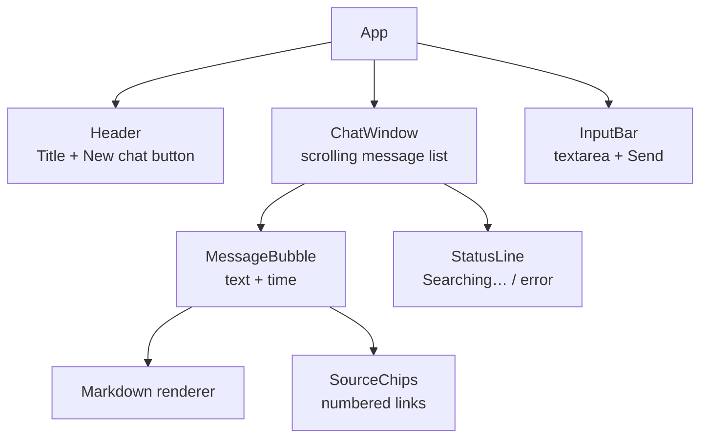
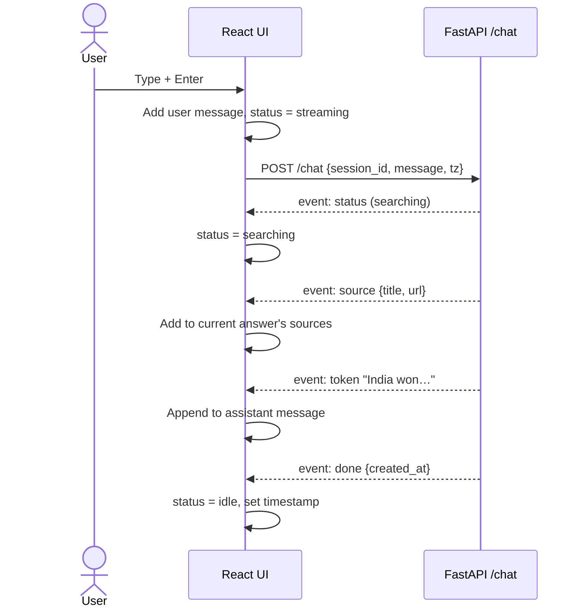

# Search Chat Agent — Frontend Design

> One React + Vite page: a chat window that streams answers, shows sources, and shows when every message was sent.

Part of [`design.md`](./design.md). This file covers the UI only.

---

## 1. Scope

**One page, one screen.** No routing, no login, no settings page.

| Feature | Included |
|---------|----------|
| Chat window with user and assistant messages | ✅ |
| Streaming answer, token by token | ✅ |
| "Searching the web…" status while the tool runs | ✅ |
| Source links under each web-based answer | ✅ |
| Timestamp on every message (local time) | ✅ |
| Session kept across page refresh | ✅ |
| "New chat" button | ✅ |
| Clear error messages (search failed, server down) | ✅ |
| Markdown rendering in answers | ✅ |
| Multiple chat list / sidebar, dark mode, auth | ❌ Future work |

---

## 2. Screen Layout

```
┌──────────────────────────────────────────────┐
│  Search Chat Agent                [ New chat ]│  ← Header
├──────────────────────────────────────────────┤
│                                              │
│            ┌─────────────────────────┐       │
│            │ Who won the match?      │ You   │
│            └─────────────────────────┘ 2:32 PM
│                                              │
│  ┌──────────────────────────────────┐        │
│  │ India won by 6 wickets [1].      │ Agent  │
│  └──────────────────────────────────┘ 2:32 PM│
│   Sources: [1 espncricinfo.com] [2 bbc.com]  │
│                                              │
│   🔍 Searching the web…                      │  ← Status line
│                                              │
├──────────────────────────────────────────────┤
│  [ Ask anything…                    ] [Send] │  ← Input bar
└──────────────────────────────────────────────┘
```

---

## 3. Component Tree



| Component | Job |
|-----------|-----|
| **App** | Holds chat state via `useChat`, lays out the page |
| **ChatWindow** | Renders messages, auto-scrolls to the newest one |
| **MessageBubble** | One message: role, markdown text, time, sources |
| **SourceChips** | Small numbered links matching the `[1]`, `[2]` citations |
| **StatusLine** | "Searching the web…" while a tool call runs, or an error |
| **InputBar** | Textarea; Enter sends, Shift+Enter adds a new line; disabled while streaming |

---

## 4. State

Kept simple with React hooks. No state library needed for one page.

```js
// useChat() returns
{
  messages: [
    {
      id,
      role: "user" | "assistant",
      content: "text so far",
      sources: [{ title, url }],
      createdAt: "2026-11-10T09:02:11Z"   // UTC, converted when displayed
    }
  ],
  status: "idle" | "searching" | "streaming" | "error",
  error: null | "message",
  send(text),
  newChat()
}
```

| Hook | Job |
|------|-----|
| **useChat** | Sends messages, reads the stream, updates `messages` and `status` |
| **useSession** | Creates a session ID, saves it in `localStorage`, loads history on start |

---

## 5. Streaming Flow

`POST /chat` returns an SSE stream. Browser `EventSource` only supports GET, so the UI reads the stream with `fetch` and a `ReadableStream` reader.



**SSE events the UI handles**

| Event | UI reaction |
|-------|-------------|
| `status` | Show "Searching the web…" |
| `token` | Append text to the assistant message |
| `source` | Add a source chip |
| `done` | Stop streaming, enable the input |
| `error` | Show the error message, enable the input |

---

## 6. Timestamps

- The backend stores and sends times in **UTC**.
- The UI converts to the browser's local timezone for display.
- The UI sends the timezone on every request (`Intl.DateTimeFormat().resolvedOptions().timeZone`), so the agent answers "when did I ask?" in the same local time the user sees.

**Display rules**

| Message sent | Shown as |
|--------------|----------|
| Today | `2:32 PM` |
| Earlier day | `10 Nov, 2:32 PM` |

Implemented in `lib/time.js` with `Intl.DateTimeFormat` (no date library needed).

---

## 7. Session & History

1. On first load, `useSession` creates a random session ID and saves it in `localStorage`.
2. On every load, the UI calls `GET /sessions/{id}/messages` and renders the saved history, with times.
3. **New chat** creates a fresh session ID. The old session stays in the database.

---

## 8. Loading & Error States

| Situation | What the user sees |
|-----------|--------------------|
| Waiting for first token | Typing dots in the assistant bubble |
| Agent is searching | "🔍 Searching the web…" |
| Search failed | The agent says so in its answer (backend sends it as text) |
| Server unreachable | "Can't reach the server. Try again." with the message kept in the input |
| Stream cut off midway | Partial answer stays, plus "Response was interrupted" |
| Empty message | Send button disabled |

The input is disabled while an answer is streaming, so two requests never overlap in one session.

---

## 9. Tech Stack

| Tech | Role | Notes |
|------|------|-------|
| **React** | UI | Hooks only |
| **Vite** | Dev server + build | Fast start, simple config |
| **Tailwind CSS** | Styling | Quick, consistent spacing |
| **react-markdown** | Render answers | Answers contain lists, bold, links |
| **fetch + ReadableStream** | Read SSE from a POST request | No extra library |

No router, no state library, no UI kit. Fewer dependencies means a faster page and less to explain.

---

## 10. Dev & Production Setup

**Development**

- `npm run dev` starts Vite.
- `vite.config.js` proxies `/chat` and `/sessions` to the FastAPI server, so no CORS setup is needed.

**Production**

- `npm run build` creates `frontend/dist`.
- FastAPI serves `dist` as static files, so the whole app runs from one server on one port.

---

## 11. Performance Notes

- The answer appears as it streams, so the user sees text within about a second.
- Streaming updates are batched (one state update per animation frame), to avoid re-rendering the whole list on every token.
- Only the last message re-renders while streaming; older messages stay memoized.
- The production build is small: React, react-markdown and the app code.

---

## 12. Build Phases

### Phase F1 — Setup
- [ ] Vite + React project, Tailwind
- [ ] Dev proxy to FastAPI

### Phase F2 — Static Chat
- [ ] Header, ChatWindow, MessageBubble, InputBar
- [ ] Markdown rendering

### Phase F3 — Streaming
- [ ] `useChat` with fetch + stream reader
- [ ] Handle `token`, `status`, `source`, `done`, `error`
- [ ] Auto-scroll, disable input while streaming

### Phase F4 — Memory UI
- [ ] `useSession` with `localStorage`
- [ ] Load history on start
- [ ] Timestamps in local time
- [ ] New chat button

### Phase F5 — Polish
- [ ] Source chips
- [ ] Error and loading states
- [ ] Mobile-friendly layout
- [ ] Production build served by FastAPI

---

## 13. Key Design Decisions

| Decision | Choice | Why |
|----------|--------|-----|
| Framework | React + Vite | Fast dev loop, familiar |
| Pages | One | The task is a single chat |
| State | React hooks | One screen, no library needed |
| Reading the stream | `fetch` + `ReadableStream` | SSE over POST, no extra dependency |
| Time display | Local time from UTC | Matches what the agent says |
| Session storage | `localStorage` session ID | Survives refresh, no login needed |
| Hosting | Built files served by FastAPI | One server, one command |

---

## 14. Future Work

- Sidebar with past chats
- Dark mode
- Stop button to cancel a streaming answer
- Copy button on answers
